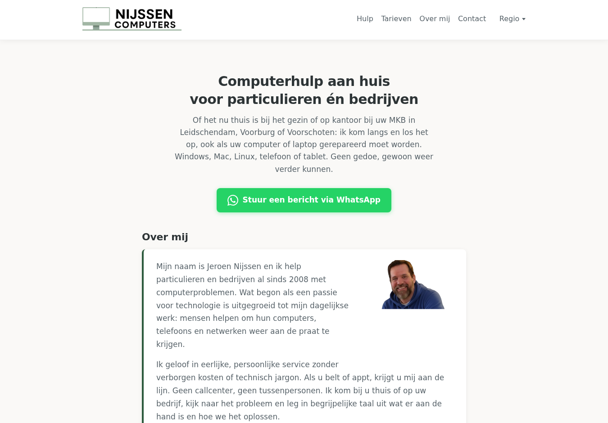
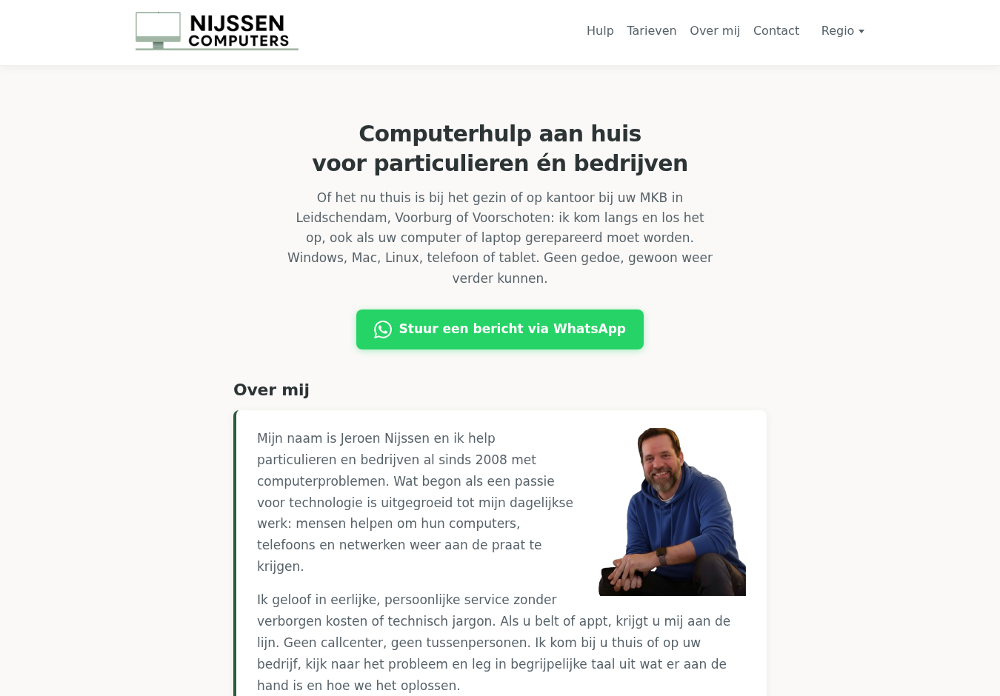

# CLS-fix — 13 oktober 2026

## Status en terugdraaipunt

Branch: `seo/cls-fix`. Verse checkout van `nijssencomputers/website`, remote `main`.
Terugdraaipunt: `c7aa26fecfd68090bc7619f0965eee346741c95b`.
Homepage geraakt: **ja** (`src/home.html`, `index.html`, gedeelde layout/CSS).
**Niet mergen of publiceren zonder Jeroens expliciete akkoord.** Productie is niet gewijzigd.

## Bewezen oorzaak

1. Het gedeferde `nav.js` voegt pas na eerste paint `nav-ready` toe. De CSS toont daarvoor de volledig uitgeklapte no-JS-navigatie. Zodra het script klaar is, krimpt de header en verschuift `main#main-content` omhoog. Dit speelt op alle drie gemeten pagina's, ook de twee dienstpagina's zonder portret.
2. Op mobiel heeft het portret vóór het laden een effectieve breedte/hoogte van 0 door `width:auto; height:auto; max-width:100%`. Na beeldmetadata ontstaat een vak van ongeveer 317 × 359 px; de eerste alinea schuift uit beeld. De opgegeven 200 × 227 attributen reserveren bij deze CSS dus niet het uiteindelijke beeldvak.

Causale tests op de live pagina, alleen lokaal in de browser geïntercepteerd:

- Normaal mobiel: `main`-shift 0,902795 en portret/alinea-shift 0,069931, samen 0,972726.
- `nav.js` twee seconden vertraagd: de grote shift schuift mee naar ~2624 ms. Desktop `main` beweegt van y=566,44 naar y=88,84 (477,59 px).
- Portret geblokkeerd: de grote navigatieshift blijft bestaan (mobiel 0,902795; desktop ongeveer 0,425 bij 1350 × 940).
- `nav-ready` vóór paint gezet, overige bron ongewijzigd: de grote shift verdwijnt; mobiel houdt alleen 0,069931 portretshift over.
- `nav.js` geblokkeerd: de uitgeklapte fallback blijft staan, zonder grote layoutshift.
- Geen fontdownload/fout in Lighthouse font-display-inzicht; de ingrepen isoleren navigatie en beeldgeometrie als oorzaak. Lighthouse noemt het portret een mogelijke oorzaak bij `main`, maar die suggestie verklaart niet de identieke shift op portretloze dienstenpagina's.

## Kleinste bronfix

- `src/layout.html`: zet `nav-ready` synchroon in de head vóór eerste paint. Bij mislukte download van `nav.js` wordt de class verwijderd zodat alle no-JS-links bereikbaar blijven.
- `style.css`: toon in de vroege verbeterde layout direct dezelfde Regio-knop in plaats van de fallbacktekst; zo blijft de menubreedte tijdens scriptinitialisatie gelijk.
- `style.css` / `src/home.html`: reserveer mobiel expliciet `width:100%` met juiste verhouding 15:17; gebruik de werkelijke afbeeldingsafmetingen 720 × 816. Desktop blijft 200 px breed.
- LCP-portret: `loading=eager`, `fetchpriority=high`; geen nieuwe afbeelding of vormgevingswijziging. De bestaande PNG blijft 559 KiB en begrenst de mobiele LCP nog steeds.
- Assetversie `20261013-cls1` om oude CSS uit caches niet met nieuwe HTML te combineren. Generator vernieuwt alle HTML en sitemap-lastmod van gewijzigde dienstpagina's.
- Bestaande browsertest corrigeert alleen een vooraf bestaande onjuiste 404-assertie: de 404 heeft bewust een contactpaginakoppeling, geen telefoonknop. De oorspronkelijke suite faalt op het ongewijzigde terugdraaipunt met exact dezelfde fout.
- Nieuwe `tests/cls_checks.py`: koude netwerkmeting, echte assets, drie pagina's, mobiel/desktop, portretmaat en mislukte navigatiedownload.

## Meetmethode

Lighthouse CLI **13.4.1**, Chrome for Testing **145.0.7632.6**, identieke standaard mobiele en `--preset=desktop` profielen, performancecategorie, nieuwe browser per run, JSON/HTML plus trace/devtools-log. Twee runs per pagina/profiel live vóór en lokaal na. Voor lokale nulmeting één run per pagina/profiel.
De aanvullende browserdiagnose gebruikt CDP, cache uit, 150 ms latency, ~1,6 Mbit/s download, 412 × 823 en 1350 × 940; screenshots zijn echte `Page.captureScreenshot`-beelden, geen placeholders. De aanvullende diagnose en Lighthouse gebruiken verschillende desktopviewports, dus hun CLS-cijfers hoeven niet exact gelijk te zijn.

### CLS en LCP (mediaan van twee runs)

| Pagina | Profiel | CLS live vóór | CLS lokaal na | LCP live vóór | LCP lokaal na |
|---|---|---:|---:|---:|---:|
| Homepage | mobiel | 0,972726 | 0,000000 | 4,59 s | 4,43 s |
| Homepage | desktop | 0,434412 | 0,000203 | 0,75 s | 0,94 s |
| Printerhulp Leidschendam | mobiel | 0,902795 | 0,000000 | 1,73 s | 1,76 s |
| Printerhulp Leidschendam | desktop | 0,434412 | 0,000000 | 0,53 s | 0,56 s |
| Laptop traag Leidschendam | mobiel | 0,902795 | 0,000000 | 1,62 s | 1,64 s |
| Laptop traag Leidschendam | desktop | 0,434412 | 0,000000 | 0,53 s | 0,53 s |

Alle twaalf nametingen halen CLS < 0,1. Hoogste nameting is 0,000406, een minimale header-shift; de overige elf zijn 0. De laatste CDP-diagnose registreert geen shift op beide viewports. De lokale nulmeting bevestigt mobiel 0,972726/0,902795 en desktop dienstpagina's 0,434412; één snelle desktop-home-run had al 0 door laadvolgorde. Dat onderstreept de oorspronkelijke race, geen afwezig probleem.

LCP is geen bewezen grote verbetering: mobiele homepage blijft >4 s door de zware bestaande PNG. Verschillen tussen live en localhost, natuurlijke runvariatie en één Lighthouse-CPU-waarschuwing bij de tweede mobiele printermeting staan in de ruwe resultaten. Geen CrUX/veldmeting en geen garantie op productie-uitkomsten. Live-na wordt pas gemeten na akkoord én daadwerkelijke publicatie.

## Controles

- `python3 tools/build.py` en `python3 tools/build.py --check`: groen, 18 pagina's plus 404.
- `python3 tools/check.py`: groen, 19 HTML-pagina's, 973 interne verwijzingen, metadata/JSON-LD/menu en homepage-invarianten.
- `python3 tests/browser_checks.py`: groen, 133 layoutcases, 57 vergrote-tekstcases, 19 no-JS-pagina's, breedtes 320–1440, menubediening, contactevents en reduced-motion. Deze suite gebruikt expliciet gelabelde beeldfixtures; echte assets zijn apart via CDP/CLS-test bekeken.
- `python3 tests/cls_checks.py`: groen, koude echte assets, CLS-bovengrens 0 voor alle zes pagina/profiel-cases; beide portrettests en beide script-uitvaltests groen.
- `python3 tests/http_checks.py` tegen lokaal Apache 2.4.68 met geleverde `.htaccess`: **74 controles groen**. Apache alleen lokaal uitgepakt, geen infra/productie-instelling gewijzigd.
- `python3 tools/build.py --deploy`: publieke export geslaagd; geen tests, bronnen of bewijsdocumenten in export.
- `node --check nav.js`, `node --check analytics-events.js`, `git diff --check`: groen.

Homepage is niet byte-identiek: technische wijzigingen hierboven zijn doelbewust. Tekst, H1, titel/description, structured data, logo, contactlinks en navigatievolgorde zijn behouden.

## Beeldbewijs

Mobiel vóór/na:

Desktop vóór/na:

De screenshots tonen de stabiele eindtoestand; shifts tijdens het laden worden bewezen door de Lighthouse-traces en PerformanceObserver-records, niet door stilstaande beelden. Volledige pagina-screenshots staan naast deze viewportbeelden.

## Ruwe bewijsbestanden en terugdraaien

De samenvattingen en causale meetrecords staan naast dit document. Volledige Lighthouse JSON/HTML/traces, lokale nulmeting en browser-/HTTP-testresultaten staan in:
`/var/lib/hermes/.hermes/profiles/website-builder/cache/scratch/cls-evidence/`.

Reproductie: `cls-audit.py` en `cls-diagnose.py` staan bij het bewijs. Voer de lokale tests uit met het Chromium-pad en de preview-URL zoals in de testargumenten.

Na een eventuele merge: `git revert <mergecommit>` (squash) of `git revert -m 1 <mergecommit>` (echte merge), gevolgd door dezelfde controles en gebruikelijke publicatieroute. Het exacte revert-commando voor de fixcommit wordt toegevoegd zodra de commit bestaat. Geen `reset --hard` of force-push op main.
